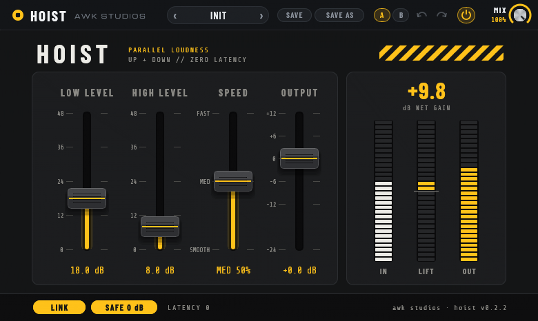

# HOIST

**Upward + downward level compressor for parallel loudness. Zero latency, almost no CPU.**



HOIST lives on a duplicate (parallel) track. Turn it up under the original and the quiet detail (room, ghost notes, tails) comes up while the hits stay put, so the part gets fatter and louder without squashing the original.

## Features

- **LOW LEVEL** (0 to +48 dB): upward compression. Quiet parts are lifted, loud parts are left alone, and silence or hiss below about -70 dBFS isn't pulled up.
- **HIGH LEVEL** (0 to -48 dB): downward compression with automatic makeup. Peaks hold while everything else gets denser.
- **SPEED** (SMOOTH to FAST): how fast the lift comes back after a hit. SMOOTH is glued with no pumping; FAST is aggressive.
- **OUTPUT** (-24 to +12 dB): the level of the squashed copy against your dry track.
- **LINK** (one gain for both channels), header **MIX**, and **SAFE** (never over 0 dBFS).
- 0 samples latency and about 0.05 % of one CPU core.
- 14 factory presets.

## Quick start

1. Duplicate your drum track (or send it to a new mixer track) and put HOIST on the copy.
2. Load **Squeeze** or **Squash**, or start at LOW 18, HIGH 8, OUTPUT -6.
3. Pull OUTPUT down to silence and bring it up under the original until the drums get thicker.
4. If the room or hiss pumps between hits, move SPEED toward SMOOTH.
## Install

Windows 64-bit, VST3. Built and tested in FL Studio.

1. Download `Hoist-v0.2.2-win64.zip` from [Releases](../../releases/latest).
2. Copy `Hoist.vst3` into `C:\Program Files\Common Files\VST3\`.
3. Copy the files in `presets` into `Documents\Awknode\Presets\Hoist\` (create the folder if it doesn't exist).
4. Rescan plugins in your DAW.

## Using it

Every awk studios plugin has the same top strip: preset browser, A/B, undo/redo, power (bypass) and a global MIX. Knobs drag up and down (hold Ctrl or Shift for fine control), scroll to nudge, and double-click to reset. **SAFE** in the footer is an output limiter that keeps the plugin from going over 0 dBFS; it's on by default.

## Build from source

You'll need Docker. Clone this repo next to the [nice-plug-awk](https://github.com/awknode/nice-plug-awk) framework fork, then run the build script:

```sh
git clone https://github.com/awknode/hoist
git clone -b awk-studios https://github.com/awknode/nice-plug-awk
cd hoist && ./build.sh
```

The plugin lands in `target/bundled/Hoist.vst3`.

## License

GPL-3.0. See [LICENSE](LICENSE). Built with [nice-plug](https://codeberg.org/RustAudio/nice-plug).

---

More awk studios plugins: [VISE](https://github.com/awknode/vise) · [SALVE](https://github.com/awknode/salve) · [KILN](https://github.com/awknode/kiln) · [PATINA](https://github.com/awknode/patina) · [CHOPSHOP](https://github.com/awknode/chopshop) · [THROWBACK](https://github.com/awknode/throwback) · [THROW FX](https://github.com/awknode/throw-fx) · [KICKNULL](https://github.com/awknode/kicknull) · [ALLEYVERB](https://github.com/awknode/alleyverb) · [WAVETAG](https://github.com/awknode/wavetag) · [dBCOMP](https://github.com/awknode/dbcomp) · [dBVOX](https://github.com/awknode/dbvox)
